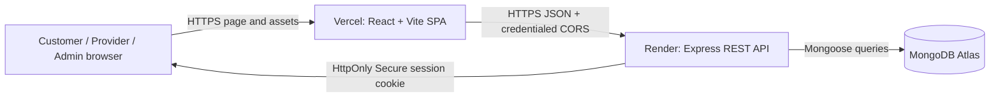
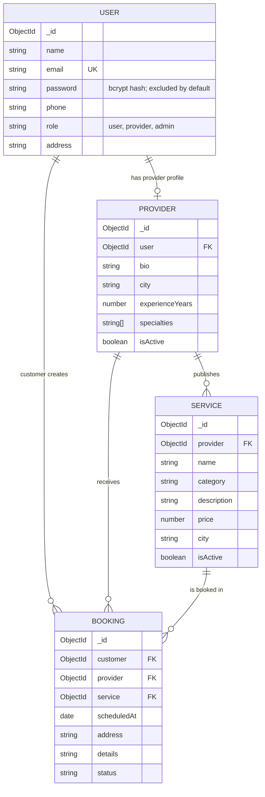
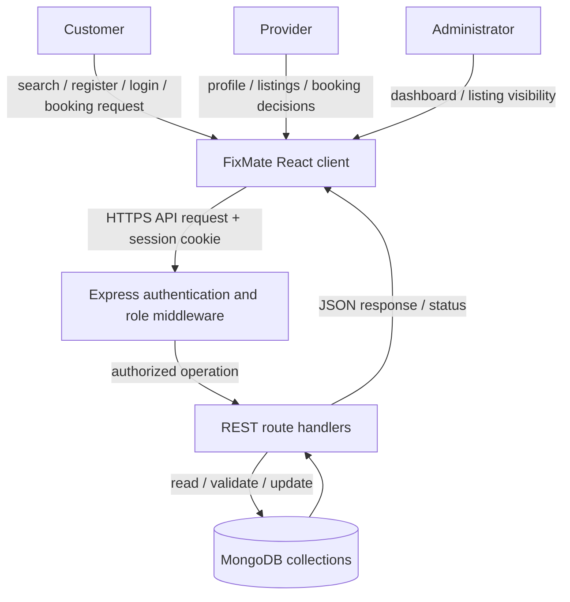
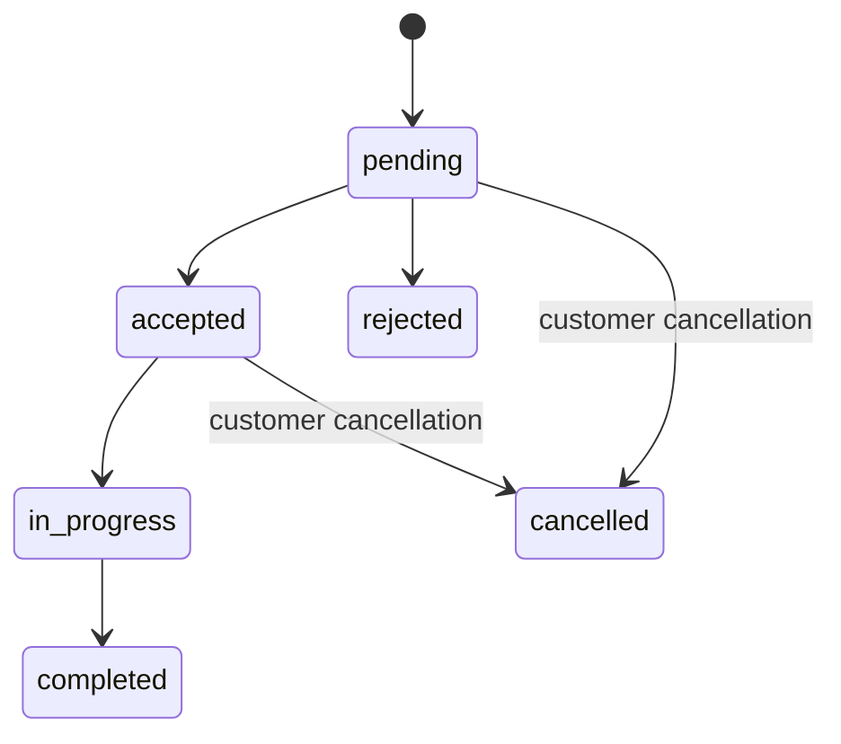

# FixMate — Local Service Booking Platform

**Project report for BCA final-year submission**

> Replace the student, institution, supervisor, and academic-session fields below with the details required by your college. Capture and insert screenshots listed in the root README before submitting a printed or exported copy.

| Submission field | Details |
|---|---|
| Student name | `[Student name]` |
| Enrollment / roll number | `[Enrollment number]` |
| Programme | Bachelor of Computer Applications (BCA) |
| Institution | `[College / university]` |
| Project guide | `[Supervisor name]` |
| Academic session | `[Academic session]` |

## 1. Project overview

FixMate is a web-based local service-booking platform that provides a common workflow for customers seeking household services and providers offering those services. Customers can discover available service listings and professionals, submit a dated booking request, and track its status. Providers can maintain a profile, manage listings, and process requests. Administrators have a protected dashboard for reviewing platform records and managing listing visibility.

The application is implemented as a React single-page frontend and an Express REST API backed by MongoDB. The deployed client and API are hosted separately, with credentialed CORS and an HttpOnly JWT session cookie connecting them.

## 2. Abstract

Finding a suitable local professional and coordinating an appointment can be difficult when service information and requests are handled across disconnected channels. FixMate addresses this problem through a role-based web application that brings service discovery, provider profiles, booking requests, and status tracking into one platform. Customers search services by category and location, then submit requests for a future date and time. Providers maintain their public profile and listings and may accept, reject, or advance requests. Customers can review their booking history and cancel a request while its status permits cancellation. Administrators review account, listing, and booking information and may hide or restore listings.

The user interface is built with React and Vite. Express exposes REST endpoints, Mongoose models application data, bcryptjs hashes passwords, and JWTs are held in HttpOnly cookies. Role checks and ownership filters protect provider and customer actions. The project is deployed as a Vercel frontend and a Render API connected to MongoDB Atlas.

## 3. Problem statement

Customers may struggle to locate nearby service providers, compare available services, and keep track of appointment requests. Providers need a straightforward way to describe their experience and offerings and to respond to customer requests. A platform that centralizes listings and request statuses can improve discovery and coordination while ensuring that customers and providers can access only the operations allowed for their roles.

## 4. Objectives

1. Provide searchable service and provider directories.
2. Support customer and provider account creation and sign-in.
3. Protect passwords and authenticate requests using signed sessions.
4. Allow customers to create, view, and cancel eligible bookings.
5. Allow providers to publish services and manage incoming booking statuses.
6. Restrict sensitive operations using authentication, roles, and record ownership.
7. Provide a limited administrator interface for reporting and service visibility.
8. Deploy the application using a separate frontend, API, and managed database.

## 5. Existing and proposed system

### Existing approach

Service discovery and appointment coordination may rely on informal directories, phone calls, or messaging. Information is distributed, availability may be unclear, and request status is difficult to follow consistently.

### Proposed system

FixMate offers public directories and role-specific authenticated workspaces. Service details and provider profiles are stored centrally. A booking moves through explicit states, and the backend validates each state transition and confirms that the acting user owns or serves the booking.

## 6. Functional requirements

- Register as a customer or provider; do not allow public administrator registration.
- Sign in, restore the current session, edit permitted profile fields, and sign out.
- List and filter active services and provider profiles by category/location.
- Open a service listing and initiate a booking flow.
- Submit a booking only as a customer and only for a valid active service and future date.
- View customer booking history and cancel pending or accepted bookings.
- View provider booking requests and transition them through permitted states.
- Create, edit, and deactivate provider-owned service listings.
- View platform statistics and account/provider/service/booking records as an administrator.
- Hide or restore a listing as an administrator without deleting its record.

## 7. Non-functional requirements

- **Security:** bcrypt password hashing; HttpOnly JWT cookies; server-side role and ownership checks; no public admin enrollment; secrets kept in deployment environment variables.
- **Privacy:** public directory responses expose only selected provider display fields; admin booking responses omit service addresses and request descriptions.
- **Reliability:** server-side validation, consistent HTTP error responses, and booking state checks.
- **Usability:** responsive layout, visible loading/error/empty states, and form constraints.
- **Maintainability:** separate route, model, middleware, and client-page modules.
- **Compatibility:** standards-based browser APIs and a Vite-built React frontend.
- **Deployment:** independently deployable client and API, with CORS restricted to configured frontend origins.

## 8. Technology stack

| Layer | Technologies |
|---|---|
| Frontend | React 19, Vite 8, React Router, Lucide React, CSS |
| API | Node.js, Express 5 |
| Data access | Mongoose |
| Database | MongoDB / MongoDB Atlas |
| Authentication | JSON Web Tokens (`jsonwebtoken`), bcryptjs, HttpOnly cookie |
| Hosting | Vercel frontend, Render web service, MongoDB Atlas |
| Tests | Node.js built-in test runner (`node:test`) and assertions |

## 9. System architecture

The frontend API helper constructs `/api` requests from `VITE_API_URL`. Authentication requests use `credentials: include`. In production, the API issues `HttpOnly; Secure; SameSite=None` cookies because the frontend and API are on different sites. CORS allows the configured `CLIENT_URL` origins and credentials.

## 10. Database design and relationships

The email field is unique. A provider belongs to one user. Services and bookings retain references to their provider and service rather than deleting related records when a listing is hidden. Timestamps support history and administrative review.

## 11. Data-flow diagram

### Booking state flow

The server checks transitions rather than trusting a status submitted by the browser. Terminal states cannot be reopened through provider status updates.

## 12. Module descriptions

### Authentication and account

Registration permits customer/provider roles only. Passwords are hashed in a Mongoose pre-save hook. Login issues a seven-day HS256 JWT in an HttpOnly cookie. The authentication middleware verifies the token and fetches the current user from MongoDB before applying role checks. Customer/provider accounts can edit name, phone, and address.

### Service directory

Public endpoints return active services attached to active provider profiles and populate only the provider display name. Searches use escaped regular expressions for category and city. Providers can create, update, and deactivate only their own listings.

### Provider directory and workspace

Public provider listings expose profile details needed for service discovery. The authenticated workspace allows a provider to update specialties, experience, city, and bio, publish listings, remove listings, and navigate to booking requests.

### Booking management

Only customers can create bookings or cancel eligible bookings. Only providers can view requests addressed to their profile or advance their statuses. MongoDB update filters include both ownership and the previously read status to guard against cross-account changes and concurrent transitions.

### Administrator dashboard

The admin API is mounted separately and applies `requireAuth` and `allowRoles("admin")` to every route. It returns counts, lists all customers/providers/services/bookings, and changes only the listing visibility flag. The public registration endpoint rejects the `admin` role. Initial promotion is performed using a server-side maintenance script for an existing account.

### Contact

The contact form prepares a `mailto:` message in the visitor's email application. It does not send or persist messages through FixMate.

## 13. API documentation

Base URL: `https://fixmate-backend-0cyg.onrender.com`. All application routes are under `/api`. JSON request bodies are used where applicable. Authenticated endpoints require the session cookie or a Bearer JWT. Role requirements are server-enforced.

| Method | Path | Access | Purpose |
|---|---|---|---|
| GET | `/health` | Public | API and database connection status |
| POST | `/auth/register` | Public | Register customer or provider |
| POST | `/auth/login` | Public | Validate credentials and create session |
| POST | `/auth/logout` | Public | Clear session cookie |
| GET | `/auth/me` | Signed in | Read current account |
| PATCH | `/auth/me` | Signed in | Update name, phone, or address |
| GET | `/services?category=&location=` | Public | Search active services |
| GET | `/services/:id` | Public | Read one active service |
| POST | `/services` | Provider | Create own listing |
| PATCH | `/services/:id` | Provider | Update own listing |
| DELETE | `/services/:id` | Provider | Deactivate own listing (blocked for active bookings) |
| GET | `/providers?category=&location=` | Public | Search active provider profiles |
| GET | `/providers/:id` | Public | Read one active provider profile |
| GET | `/providers/me` | Provider | Read own profile |
| PATCH | `/providers/me` | Provider | Update own profile |
| POST | `/bookings` | Customer | Create booking for an active service |
| GET | `/bookings/mine` | Customer | Read own booking history |
| PATCH | `/bookings/:id/cancel` | Customer | Cancel own pending/accepted booking |
| GET | `/bookings/provider` | Provider | Read requests for own provider profile |
| PATCH | `/bookings/:id/status` | Provider | Advance/reject an owned booking |
| GET | `/admin/overview` | Admin | Read aggregate account/service/booking counts |
| GET | `/admin/users` | Admin | Read customer/provider accounts |
| GET | `/admin/providers` | Admin | Read provider profiles |
| GET | `/admin/services` | Admin | Read service listings |
| PATCH | `/admin/services/:id/status` | Admin | Set listing `isActive` to a boolean |
| GET | `/admin/bookings` | Admin | Read all bookings without addresses/details |

Expected errors include `400` for invalid input, `401` when authentication is missing/invalid, `403` for an authenticated account with the wrong role, `404` for a missing resource, `409` for duplicate/conflicting operations, and `500` for unexpected server errors.

## 14. Testing and test cases

The backend suite uses Node's built-in test runner and starts an ephemeral HTTP server without connecting to a test database. It covers health response privacy, anonymous authentication/booking/provider/admin access, registration validation (including blocking public admin registration), invalid login payload validation, provider/admin role guards, verification that the current database role supersedes the JWT role claim, service ID validation, session cookie policy, booking transition rules, and seed fixture uniqueness.

| Test case | Expected behavior |
|---|---|
| Health endpoint | Returns success and connection state without database credentials |
| Anonymous booking/provider/admin access | Rejected with HTTP 401 |
| Invalid registration/login input | Rejected before database writes/lookups |
| Public admin registration | Rejected |
| Customer against provider/admin role guard | Rejected with HTTP 403 |
| Signed JWT with stale administrator claim | Uses the current role loaded from the user record |
| Booking status transition | Only the configured state transitions are allowed |
| Production cookie settings | HttpOnly, Secure, SameSite=None |
| Development cookie settings | HttpOnly, not Secure, SameSite=Lax |
| Frontend lint/build | ESLint passes and Vite emits a production bundle |

Database-backed registration, login, booking creation/cancellation, provider status updates, and administrator operations require a dedicated test database and role-specific accounts. The repository's automated suite does not claim to execute those MongoDB-backed flows.

## 15. Installation and setup

1. Install Node.js 20+ and MongoDB Community or provision a MongoDB Atlas database.
2. Copy `server/.env.example` to `server/.env`. Add a valid `MONGO_URI`, a random `JWT_SECRET` of at least 32 characters, and `CLIENT_URL=http://localhost:5173`. Keep this file untracked.
3. Run `npm install` in `server`, then `npm test` and `npm start`.
4. Run `npm install` in `client`, then `npm run dev`.
5. Open the Vite URL shown in the terminal.
6. Register a customer or provider account through the app.

The local frontend defaults to the API at `http://localhost:5000`. Set `VITE_API_URL` if the API runs elsewhere.

## 16. Deployment instructions

### Frontend (Vercel)

1. Connect the GitHub repository and set the project root to `client`.
2. Set `VITE_API_URL=https://fixmate-backend-0cyg.onrender.com`.
3. Use `npm run build`; Vite outputs `client/dist`.
4. Deploy and verify direct route refreshes, directory reads, and the loaded JavaScript bundle's API origin.

### Backend (Render)

1. Create a Node web service from the repository with root directory `server`.
2. Use `npm install` and `npm start`.
3. Set `MONGO_URI`, `JWT_SECRET`, and `CLIENT_URL=https://fixmate-beta.vercel.app` in Render's private environment settings.
4. Do not configure production secrets in a source file or Vite environment variable.
5. Deploy and verify `/api/health`, CORS for the Vercel origin, public directories, and role-protected operations.

### First administrator

Create a regular customer account, then run `ADMIN_EMAIL=<existing-account-email> npm run admin:promote` in the server environment with the intended MongoDB URI configured. On Windows PowerShell, set `$env:ADMIN_EMAIL` before the command and remove it afterward. The script updates that existing account's role only; it creates no public admin endpoint. Grant the role only to a trusted account and sign in again after promotion.

## 17. Future scope

- Email verification and password recovery.
- Provider identity/document verification and administrator account controls.
- Rating and review workflow after completed bookings.
- Payment integration with transaction and refund handling.
- Notifications for booking status changes.
- Pagination/filtering and audit logs for administrative views.
- Dedicated integration and browser end-to-end testing against an isolated database.
- Accessibility review and localization.

## 18. Conclusion

FixMate demonstrates a full-stack booking workflow with public service discovery, customer/provider accounts, role-protected booking operations, persisted MongoDB data, and a separately provisioned administrative dashboard. It separates presentation, API routes, authorization middleware, and data models, and includes automated tests for core API safeguards and booking state rules. Prior to a formal production demonstration, the database-backed role workflows should be exercised using dedicated test accounts, and project-specific student details and screenshots should be added to this report.
